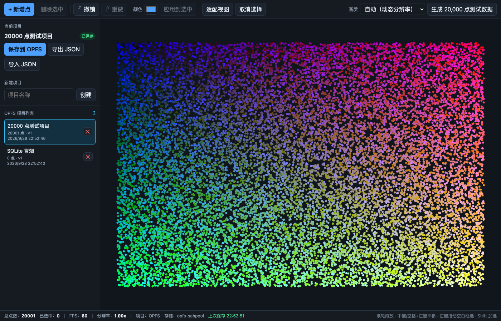
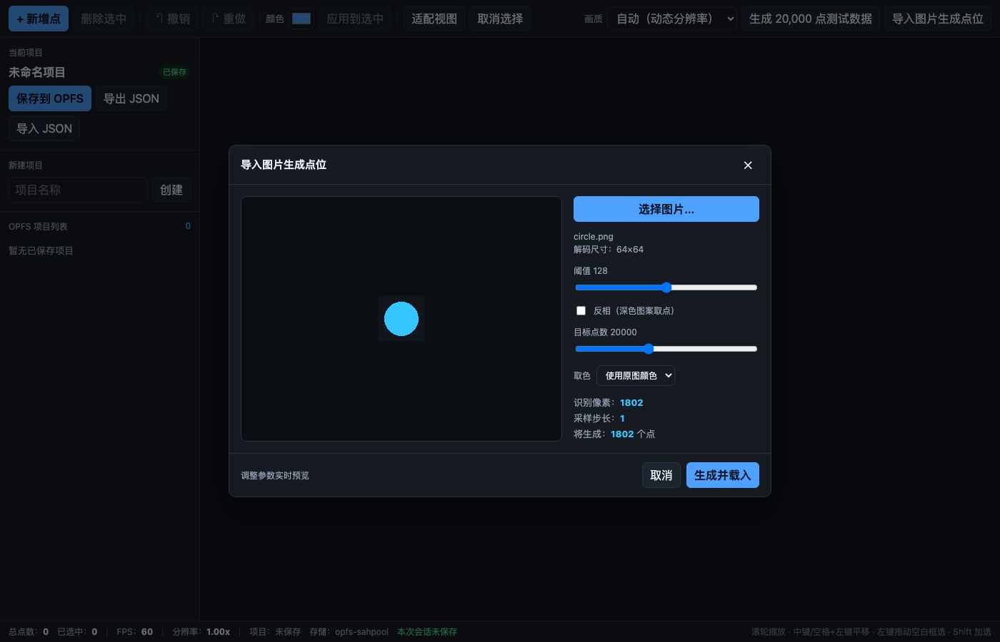
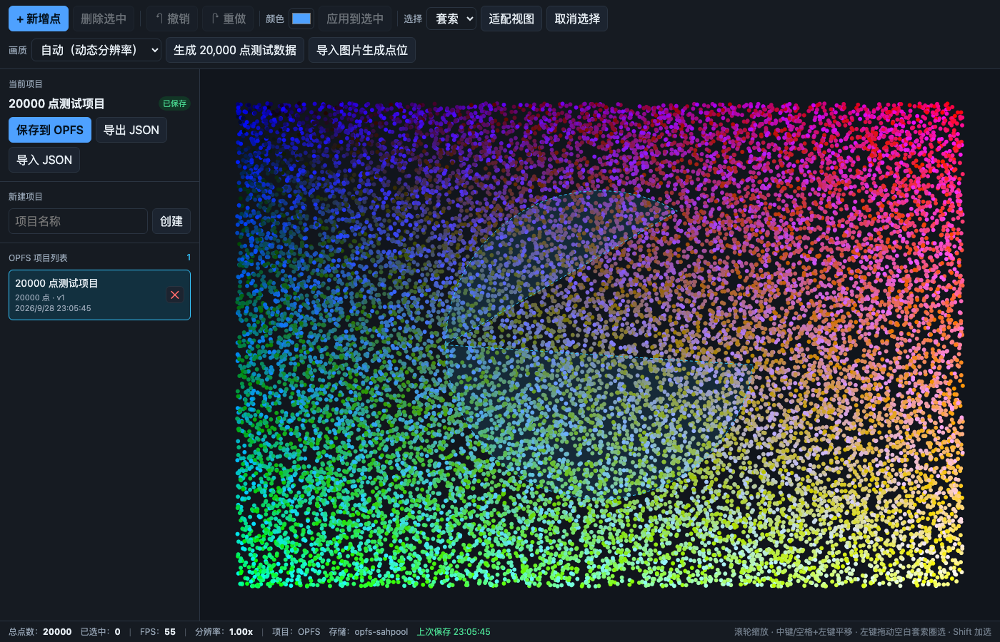
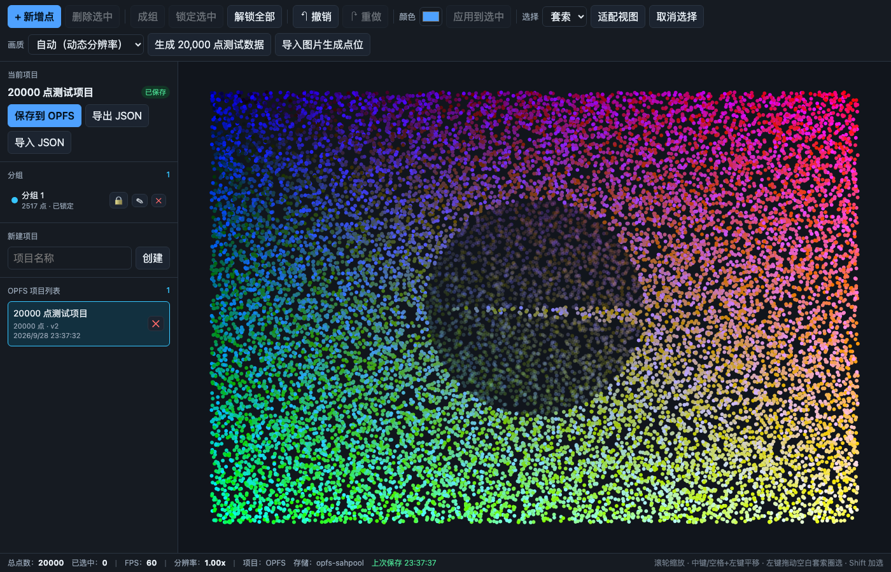

# SwarmStudio · 二维点阵编辑器

面向无人机集群表演创作系统的二维点编辑器 Demo。使用 **Vue 3 + TypeScript**，
以 **PixiJS** 完成主要点位渲染，项目数据通过 **SQLite(WASM) 存储在 OPFS**，
所有数据库读写都在独立的 **Web Worker** 中执行，主线程与 Worker 之间有一层
**任务队列** 做串行化与合并。

项目采用**视频编辑器式的时间线**：一条**轨道**上排列若干**帧片段**（每帧来自一张
导入图片），相邻帧之间可插入**过渡**（可配置时长 / 匹配算法 / 运动轨迹 / 缓动），
画布下方即时间线，可播放 / 暂停 / 拖动播放头预览过渡。项目有固定的**无人机总数**，
每帧只使用其中一部分。

## 环境要求

| 项目 | 版本 |
| --- | --- |
| Node.js | v20+（开发使用 v24.8.0） |
| 包管理器 | pnpm 10（`packageManager: pnpm@10.18.2`） |
| 浏览器 | Chromium 内核 / Firefox 111+ / Safari 16.4+（需支持 OPFS 与 Worker） |

## 安装与启动

```bash
pnpm install
pnpm dev            # 开发，默认 http://localhost:5173
pnpm build          # 类型检查 + 生产构建
pnpm preview        # 预览构建产物
pnpm typecheck      # 仅类型检查（vue-tsc）
pnpm test           # 单元测试（vitest）
pnpm gen            # 生成 20,000 点测试数据 -> data/test-20000.json
pnpm smoke          # 无头浏览器端到端冒烟（编辑器，需要本地 Chrome）
pnpm smoke:image    # 无头浏览器端到端冒烟（图片生成点位）
pnpm smoke:select   # 无头浏览器端到端冒烟（Shift 加选 / 套索圈选）
pnpm smoke:groups   # 无头浏览器端到端冒烟（成组 / 锁定 / 刷新恢复）
```

> 冒烟脚本依赖本机 Chrome，可用 `CHROME_PATH=/path/to/chrome pnpm smoke` 指定。

## 在线 Demo（GitHub Pages）

仓库内置 `.github/workflows/deploy.yml`：推送到 `main` 会自动跑测试、构建，并以子路径
`/<repo>/` 发布到 GitHub Pages。**首次需在 仓库 Settings → Pages → Source 选择
「GitHub Actions」**，之后地址为：

```
https://ny15234532582.github.io/swarmstudio-2d-editor/
```

> 选 `opfs-sahpool` 的原因之一就是它**不需要 COOP/COEP 响应头**，因此可以直接静态托管。
> 本地验证子路径构建：`BASE_PATH=/swarmstudio-2d-editor/ pnpm build`。

## 技术选型

- **PixiJS 8**（`package.json` 声明 `^8.6.6`，实际安装 **8.21.0**）：每个点用一个共享圆形
  纹理的 `Sprite`（而非逐点 `Graphics`），由 GPU 合批，20,000 点接近常数个 draw call；
  移动 / 改色只改对应 Sprite 属性。`Application.init({ preference: 'webgl', antialias: false })`，
  渲染分辨率由 `renderer.resize(w, h, resolution)` 控制。
- **SQLite WASM（`@sqlite.org/sqlite-wasm`）**：用 SQL 封装项目数据，
  结构化查询、事务、增量写入都更直接。
- **ECharts**：过渡统计的图表（距离分布直方图、速度/进度曲线、峰值/上限占比），随参数实时更新。
- **OPFS `opfs-sahpool` VFS**：数据库文件存放在 OPFS。选择该 VFS 的原因：
  - 不需要 COOP/COEP 响应头，可直接静态托管（GitHub Pages 等）；
  - 批量写入性能最好；
  - 代价：不支持多标签同时写（单用户编辑器可接受）。
- **Web Worker + 任务队列**：OPFS 的同步访问句柄与 SQLite(WASM) 都只在 Worker 可用；
  队列负责串行化、合并（连续保存合并为一次写入）与错误传播。
- **独立 compute worker**：图片解码后的像素运算（灰度、二值化、抽稀）单独一个 Worker，
  与存储 Worker 隔离，避免大图计算卡住主线程或占用数据库事务时间。

## 架构与通信

### 分层

| 目录 | 角色 | 依赖 |
| --- | --- | --- |
| `core/` | 领域内核：类型、`Operation` 契约、校验、几何/空间索引、ID | 无 |
| `state/` | 内存事实源：`EditorStore` + `HistoryManager` + 事件总线 | `core` |
| `render/` | 显示层：PixiJS 渲染、视口变换、指针交互 | `core`、`state` |
| `data/` | 持久化层：Worker + 任务队列 + SQL + 迁移 | `core`（+ `state` 事件总线与类型） |
| `compute/` | 计算层：图片→点阵（独立 Worker） | `core` |
| `ui/` | 页面层：Vue 组件、状态桥接、命令转发 | 以上全部 |

依赖方向单一：`ui → render/data/compute/state → core`，反向依赖为零。

### 两条通信通道

`EditorStore` 广播两类事件，走两条完全不同的通道：

| | 通道① 渲染 | 通道② 持久化 |
| --- | --- | --- |
| 事件 | `points:add/remove/move/color`、`points:lock`、`groups:change`、`selection:change` | `mutation`、`history:change` |
| 触发 | 任何数据变化（含拖动预览） | 仅**已提交**的操作（含 Undo/Redo） |
| 处理 | 渲染层订阅后**直接调 Pixi API** 改 Sprite | 进队列 → Worker → SQL |
| 跨线程 | 否（同线程同步） | 是（`postMessage` 结构化克隆） |
| 落盘 | 否 | 是 |

### 两层任务队列

```
EditorStore ──mutation──▶ DataService（缓冲 + 400ms 防抖）
                              │
                              ▼
             主线程 TaskQueue（串行 + 同 key 合并 + 错误传播）
                              │  postMessage（只传纯数据）
                              ▼
             Worker incoming 顺序队列（while 循环取出）
                              ▼
             Repository → db.transaction() → SQLite(WASM) → OPFS
```

- **主线程队列**管调度：连续保存/改色合并成一次写；
- **Worker 队列**管顺序：保证单连接上不出现交叉事务；
- 渲染事件**不进队列**，由 Pixi 直接改对象、ticker 绘制。

## 目录结构

```
src/
  core/          纯领域层：类型、Operation 契约、校验、几何、空间索引、ID、过渡引擎
  state/         EditorStore（运行时事实源）、HistoryManager、事件总线
  render/        PixiJS 渲染、视口变换、指针交互、过渡预览层
  data/          数据操作层（不依赖 Vue）
    protocol.ts   主线程 ↔ Worker 消息协议
    schema.ts     建表与迁移（PRAGMA user_version）
    repository.ts 全部 SQL
    worker.ts     SQLite + OPFS(opfs-sahpool) + 顺序执行队列
    queue.ts      任务队列（串行 / 合并）
    client.ts     DataClient：类型化 API + 请求调度
    service.ts    门面：项目 CRUD、自动保存、导入导出
    json.ts       JSON 导入导出
  compute/       图片 → 点阵（纯计算 + 独立 compute worker）
    imageProcessor.ts  二值化 / 抽稀 / 坐标映射（纯函数，可 Node 单测）
    worker.ts          像素运算 Worker
    client.ts          解码图片 + 调用 Worker
  ui/            Vue 组件与状态桥接（含 Timeline 时间线 / TransitionEditor 过渡编辑器）
scripts/         测试数据生成 + 4 个无头冒烟（编辑器 / 图片 / 选择 / 分组）+ 文档转换
tests/           vitest 单元测试
docs/design.md   设计说明
```

分层：`core`（领域内核，无依赖）← `state`（内存事实源）← `render`（PixiJS）/
`data`（SQLite+OPFS）/ `compute`（图片计算 Worker）← `ui`（页面）。依赖方向单一，
详见 [设计说明 §2 系统结构](docs/design.md)。

## 数据模型与版本

存储分两层：**内存层**（`EditorStore` + `HistoryManager`）是运行时权威事实源，
渲染 / 交互 / Undo-Redo 都只读它；**磁盘层**（OPFS 上的 SQLite）是持久化投影。
写路径为「内存改 → mutation → 队列 → SQL 事务」，读路径为「SQL → 物化进内存」，
磁盘始终跟随内存，不会出现两个事实源。

```ts
interface Project { version; id; name; createdAt; updatedAt; droneCount; tracks: Track[]; points: Point[]; groups: Group[] }
interface Track { id; name; clips: Frame[]; transitions: Transition[] }   // 当前只有 1 条轨道
interface Frame { id; name; thumbnail; width; height; duration }          // 时间线上的帧片段（停留时长）
interface Transition { id; fromFrameId; toFrameId; duration; algorithm; path; easing; params }
interface Point { id; x; y; z; r; g; b; frameId; droneIndex?; groupId?; locked? }
```

- `x/y/z` 为有限数值，`r/g/b` 为 0~255 整数；画布只按 XY 显示，**保存/导入导出完整保留 z**。
- 点位通过 `Point.frameId` 归属到某个帧；画布只显示**当前帧**的点。
- 项目固定 `droneCount`（无人机总数）；每帧图片按最小间距采样，超过上限则自动增大步长压回上限，
  因此每帧只用其中一部分无人机（数量可不同）。
- 过渡（分层，参数丰富）：相邻帧之间的独立区段，`duration` / `stagger` 可调。界面上分**简单/高级**两档，普通用户选风格预设即可。
  - ① 分配 = **加权评分 + 求解器**：`score = Σ wₖ·项ₖ`，每项都**归一到 [0,1]**（量纲一致，权重才表示"相对重要性"），项含
    `wDist·(d/对角线)`(总路程)、`wEven·min(1,|d−d*|/d*)`(**均匀度**，可让各点移动距离更接近)、`wAngle·(1−cos)/2`(方向一致)、`wGroup`(同组，0/1)、`wOrder·|名次差|/(n−1)`(保持顺序)、`wRadial·|Δr|/对角线`(保持半径)、`wAngular·Δθ/π`(保持极角)；
    求解器 `algorithm`：匈牙利（最小化总得分）/ 拍卖（近似）/ 瓶颈（**最小化最大得分**，默认）/ 最近邻 / 按索引；
    可调 `neighborLimit`(候选近邻，源∪目标并集)、`epsilon`、`secondaryMinTotal`；均匀度用**迭代目标距离 d\***实现（`targetDistance/evenIterations/evenMode`）；
  - ② 路径 `path`：直线 / 弧线 / 三次贝塞尔；可调 `curvature`、`arcDirection`、`waveAmp`；
  - ③ 速度剖面 `velocityProfile`：线性 / 缓动 / 梯形(S曲线) / 最小 jerk；可调 `easing`、`accelRatio`、`speedMode`(同时到达/等速)；
  - ④ 相位 `stagger` + `staggerOrder`（序号/距离/分组/随机）；
  - ⑤ 安全：`minSeparation`(最小间距斥力) + `separationStrength`；
  - 项目级 `droneLimits`（最大速度/加速度）+ 过渡级覆盖，用于校验峰值速度/加速度。
  - **未使用无人机**（每帧只用一部分机队）：默认**飞往阵型下方的待命区**的固定槽位、**暗显待命**，需要时再飞回目标——全程在空中、消除“凭空出现”；可切换为**原地淡入淡出**。参数 `unusedMode/parkGap/parkSpacing/parkDim`。
  - 简单模式预设（一键套权重）：最短路程 / 最均匀 / 平行流动 / 保持分组 / 保持环状 / 顺序流动 / 快速会聚。
- 业务数据与界面临时状态分离：`selected`、`hovered`、`dragging`、`activeFrameId` 不写入项目数据。
- 分组为独立注册表 `Project.groups: Group[]`，点位只存 `groupId` 引用；锁定只存在点位上。

两套版本分开：

| 版本 | 位置 | 说明 |
| --- | --- | --- |
| 项目数据格式版本 | `projects.version` / `Project.version` | 随项目保存，导入时校验 |
| 数据库结构版本 | `PRAGMA user_version` | 由 `data/schema.ts` 管理 |

数据库表：`projects`、`tracks`、`frames`、`points(project_id,frame_id,id,...)`、
`transitions(project_id,id,...)`、`groups`、`history`，外键 `ON DELETE CASCADE`，
删除项目自动级联清理。**本项目不兼容历史结构**：结构版本不一致时直接重建（丢弃旧表）。

## 功能

- PixiJS 画布：加载 / 绘制、RGB 显色、平移、缩放与适配、单点选中高亮、拖动
- 点位编辑：新增、删除、移动、多点选择（Shift 加选 / 框选 / 套索）、批量改色、取消选择
- 选择：左键点空白框选、点住点拖动；**Alt/Option + 左键拖拽 = 套索**（可圈任意形状），Shift 追加
- 分组与锁定：选中后「成组」，可整组选中 / 重命名 / 取消分组；「锁定」后该点（或整组）
  不可被选中 / 拖动 / 删除 / 改色，并在画布上变暗提示
- 状态显示：当前帧点数 / 无人机总数、总点数、选中数量、FPS、渲染分辨率、存储后端
- 渲染质量：自动（按 FPS 动态分辨率）/ 高（原生）/ 均衡（75%）/ 流畅（50%）
- Undo / Redo：新增 / 删除 / 移动 / 改色 / 成组 / 锁定 / 帧增删与排序 / 过渡增改，快捷键 `Cmd/Ctrl+Z`、`Shift+Cmd/Ctrl+Z`
- 项目存储：创建、保存、打开、删除、刷新恢复、导出 / 导入 JSON；删除当前项目会同时清空画布
- 无人机总数：在工具栏设置（项目参数），作为每帧采样点数的上限
- 点大小可调：工具栏「点半径(米)」按**无人机实际大小**渲染（默认 0.5，可实时缩放），选中环/预览点同步缩放
- 比例尺：画布左下角按当前缩放显示「N m」比例尺（世界坐标=米），随缩放实时更新
- 图片生成帧：时间线「＋ 新增帧」→ 导入图片 → 阈值二值化（可反相）→ 按最小间距换算网格步长抽稀（受无人机总数上限约束）→ 生成点阵并作为**新帧**追加到时间线，全程在独立 compute worker，参数实时预览
- 帧编辑：点帧块上的「✎」弹出编辑弹窗，回填该帧源图与采样参数，可改名称 / 停留时长 / 采样参数并重新生成该帧点位（帧 id 不变，过渡引用不失效）；也可重新选择图片替换
- 时间线（视频编辑器式）：单轨道横向排列帧缩略图；帧可点选 / 删除 / 拖拽排序；片段之间可**新增过渡**
- 过渡设置（右侧停靠栏，不遮挡时间线/播放）：**简单模式**只选「风格预设」（最短路程/最均匀/平行流动/保持分组/保持环状/顺序流动/快速会聚，命中会高亮）+ 调时长/节奏；**高级模式**再暴露求解器与 7 条权重滑条、路径、速度剖面、错峰、约束与全部专业参数
- **过渡产物（类“导出”）**：点【预览】在 Web Worker 里计算该过渡的**轨道（匹配）+ 统计**（**仅内存**，据此显示统计/图表/轨迹、可播放）；点【新增】/【保存修改】才把「过渡参数 + 产物（冻结的帧点位/参数/分配/统计）」**持久化到 OPFS 的 SQLite 表 `transition_renders`**。改帧或改参数不会自动更新已保存产物，需手动重新预览+保存；删除过渡/项目级联删除产物。播放全程按**产物**逐帧采样，不再实时匹配（未生成产物的过渡不可播放）
- **安全检测（硬约束）**：对过渡产物按 **30fps** 采样、逐架数值微分求速度/加速度分量、网格求全 3D 最小间距，与**固定 7 项限值**比较——最小间距 ≥1.5、水平速度 ≤4.5、上升/下降速度 ≤3.5/3.0、水平/上升/下降加速度 ≤4.5/4.0/3.5（长度=米、时间=秒）。**不通过则禁止保存**；提供「安全适配」：按限值反推最小过渡时长（速度∝1/T、加速度∝1/T²），间距不足则开启**深度分层避让**
- **深度分层避让（去冲突）**：x/y 仍走直线（不改正面画面），仅沿**深度轴 z** 给过近的机对分层——① 采样若干帧统计「任一时刻 3D 距离 < 阈值」的机对，建**并集冲突图**；② **贪心着色**（度数降序 first-fit），同色机永不相冲、异色机深度差 ≥ 间距；③ 层号居中减小振幅，乘平台 bump（可关，默认恒偏移）使两端回零。因深度只增加与 (x,y) 正交的距离，**绝不制造新冲突**，单调安全；结果烘进产物（`RenderPayload.avoid`）。真实 3000 机数据约需 21 层、最大深度 ~20m，可把中段最小间距从 ~0 提升到 ~1.87
- **导入真实轨迹（`.jsdm`）**：自动识别 Blender 导出的无人机轨迹（`pointFrames` 关键帧）→ 每个关键帧转为一帧、相邻关键帧转为一个过渡（稳定编号 `no`、默认按索引匹配、颜色取 `channelFrames`）；坐标按 XZ 竖直平面映射（`file.z 取反 → 画布y`，避免上下镜像；时长按毫秒差换算秒）
- 播放预览：播放 / 暂停整条时间线，或单独预览某个过渡；播放头可拖动 seek
- 自动保存：提交后 400ms 防抖；拖动期间的 `pointermove` 不触发持久化
- 未保存保护：新建 / 打开 / 导入 / 生成帧前，若有未保存修改会先询问是否保存

## 快捷键与操作

| 操作 | 方式 |
| --- | --- |
| 缩放 | 滚轮（以光标为中心） |
| 平移 | 中键拖动 / 空格 + 左键拖动 |
| 框选 | 左键在空白处拖拽 |
| 套索圈选 | **Alt/Option + 左键拖拽**，从任意位置起笔 |
| 加选 / 反选 | Shift + 左键点选；Shift + 框选/套索为追加 |
| 删除选中 | Delete / Backspace |
| 撤销 / 重做 | Cmd/Ctrl+Z / Shift+Cmd/Ctrl+Z |
| 保存 | Cmd/Ctrl+S |

## 界面预览



（20,000 点数据；左下角显示总点数、FPS、实际渲染分辨率、存储后端 `opfs-sahpool`。）



（导入图片 → 二值化实时预览 → 生成点位。）



（Alt + 拖拽套索，自由圈选区域，落点即选中。）



（套索圈选 → 成组 → 锁定：锁定区域变暗，且不再可点选。）

## 测试与性能验证

### 性能验证环境

| 项 | 值 |
| --- | --- |
| 机器 | macOS 26.6.2 / Apple Silicon (arm64) |
| 浏览器 | Google Chrome 153.0.8010.53（`pnpm smoke` 使用无头模式） |
| 渲染 | 无头 SwiftShader **软件渲染，无 GPU**（属最不利情形） |
| Node / pnpm | v24.8.0 / 10.18.2 |
| 数据 | 20,000 点（`pnpm gen` 生成，确定性种子可复现） |

- `pnpm test`：89 个用例（11 个测试文件）
  - `repository`：在 Node 内存库上验证建表、增量写入、锁定/分组/过渡持久化、历史裁剪(100)、级联删除
  - `migration`：空库迁移、重复迁移、以及「结构版本不一致时重建」
  - `queue`：任务串行、同 key 合并、错误隔离
  - `history` / `operations`：撤销重做的前后状态
  - `transition`：加权评分（距离/均匀/方向/同组/顺序/半径/极角）、求解器（索引/最近邻/匈牙利/拍卖/瓶颈）、均匀度迭代、候选近邻并集、等速时间模型、错峰排序、最小间距斥力、贝塞尔路径、**未使用无人机飞往待命区**、**产物（签名/构建/采样/轨迹）**、峰值速度/加速度/距离统计、时间线区段映射
  - `safety`：安全检测（速度/加速度分量峰值、全 3D 最小间距、最小时长反解）
  - `imageProcessor`：二值化、反相、透明像素、最小间距→步长换算、无人机上限压缩、坐标映射
  - `geometry`：套索的点在多边形内判定（射线法）
  - `groups`：成组 / 拆组 / 归属迁移 / 锁定不可选中与不可删除 / 撤销重做
  - `validation` / `spatial`：数据校验与空间索引
- `pnpm smoke`：无头 Chrome 端到端——创建项目 → 导入 20,000 点测试数据 → 编辑 → 自动保存 →
  刷新 → 从 SQLite 重新打开 → **撤销历史仍可用** → 删除当前项目后画布清空。
- `pnpm smoke:image`：注入一张图片 → 二值化预览 → 生成点位 → 作为新帧追加到时间线。
- `pnpm smoke:select`：单击选中 → **Shift 加选** → Alt 套索 → Shift+Alt 追加 → **拖拽移动点位**，
  逐步校验「已选中」数量与撤销记录。
- `pnpm smoke:groups`：套索圈选 → 成组 → 锁定 → 刷新重开后分组与锁定仍在 → 解锁后可再选中。
- 性能：界面右下角实时显示 FPS 与实际渲染分辨率。画质档位按**相对设备像素比**定义：
  高=原生、均衡=75%、流畅=50%，`自动` 按 FPS 动态升降。
  实测（20,000 点，无头软件渲染）：

  | 档位 | DPR=1 | DPR=2（Retina） |
  | --- | --- | --- |
  | 高（原生） | 1.00x / 60 FPS | 2.00x / 23 FPS |
  | 均衡（75%） | 0.75x / 60 FPS | 1.50x / 37 FPS |
  | 流畅（50%） | 0.50x / 60 FPS | 1.00x / 60 FPS |

  即：画质档位在 **Retina 上作用显著**，在普通 1x 屏上需要选低于原生的档位或 auto 才有变化。
  另外，把 20,000 点从约 28 FPS 提到约 60 FPS 的主要收益来自**关闭 MSAA**
  （改用带抗锯齿的纹理），与画质菜单无关。真机 GPU 下更高，draw call 接近常数。
  加载、平移、缩放、拖动均保持可交互。

复现性能测试：`pnpm gen 8000` 生成不同规模数据，用「导入 JSON」载入后观察 FPS 与操作耗时。

## 已知问题与未完成

- `opfs-sahpool` 不支持多标签并发写；同源多开时后开的标签会初始化失败并降级为内存模式。
- 历史仅持久化 Undo 栈（最近 100 条），Redo 栈不持久化。
- 增量写入目前对移动 / 改色逐行 `UPDATE`，尚未做语句级批量优化。
- 图片抖动手法（halftone）尚未加入；点数到十万级需进一步优化（见设计说明第 10 节）。

## AI 使用说明

开发过程中使用了 AI 辅助生成代码骨架与文档草稿。所有核心设计（数据模型、
Operation 契约、任务队列、SQLite 表结构与迁移、渲染方案）均经过人工审阅，
关键代码可在面试中逐行解释。

## 设计说明

- **Markdown（源）**：[`docs/design.md`](docs/design.md)
- **Word（交付）**：[`docs/design.docx`](docs/design.docx)
- **过渡计算流水线（匹配 / 避让 / 安全 · 并发与缓存）**：
  [`docs/render-pipeline.md`](docs/render-pipeline.md)

Word 版由 `bash scripts/md-to-docx.sh` 从 Markdown 生成（`marked` + LibreOffice，
不需要额外安装依赖），二者内容一致。
